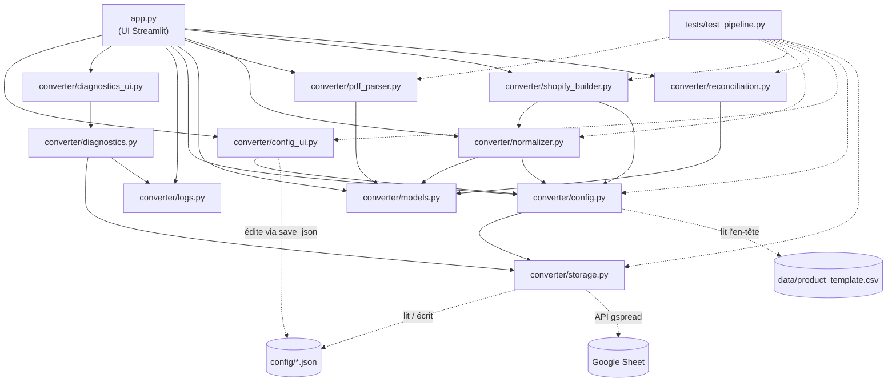

# 📘 Documentation technique — Convertisseur Facture/BL → CSV Shopify

> Ce document décrit l'architecture, le rôle de chaque fichier, les flux d'exécution et la marche à suivre pour faire évoluer le projet. Pour l'usage courant, voir `README.md`.

---

## 1. 📌 Vue d'ensemble du projet

### Objectif
Application web interne qui :
1. **Convertit** une facture ou un bon de livraison (BL) fournisseur au format PDF en **fichier CSV d'import produits Shopify** (colonnes identiques au template, variantes regroupées, règles de titre/prix/poids/tags appliquées).
2. **Rapproche** un Bon de Commande (PO) d'un BL : liste des écarts + quantités dans l'ordre exact du PO, prêtes à être collées dans Shopify.
3. Permet de **gérer les règles métier** (marques, couleurs, types, mapping, collections) depuis l'interface, sans toucher au code.

Le traitement est **100 % déterministe** (regex + règles de config) : aucun appel LLM. La configuration peut vivre dans des fichiers JSON (défaut) ou dans un **Google Sheet** servant de petite base de données partagée (optionnel).

### Stack technique

| Domaine | Outil |
|---|---|
| Langage | Python 3.10+ |
| Interface | Streamlit ≥ 1.50 (`st.data_editor`, `st.dialog`, `st.tabs`) |
| Données tabulaires | pandas ≥ 2.0 |
| Lecture PDF | pypdf ≥ 4.0 (PDF texte uniquement, pas d'OCR) |
| Configuration | Fichiers JSON dans `config/` **ou** Google Sheets (gspread ≥ 6, compte de service) |
| Tests | pytest |
| Versionnement | Git / GitHub |

---

## 2. 🗂 Structure, contenu et rôle des fichiers

### Arborescence

```text
shopify-invoice-converter/
├── app.py                          # Point d'entrée Streamlit (UI + orchestration)
├── converter/                      # Package métier
│   ├── __init__.py
│   ├── config.py                   # Constantes, profils, façade load/save vers le backend actif, colonnes template
│   ├── storage.py                  # Backends de config : JSON local / Google Sheets (gspread)
│   ├── logs.py                     # Journalisation : console + fichier + tampon mémoire, masquage des secrets
│   ├── diagnostics.py              # Diagnostic pas à pas de la connexion Google Sheets (pur)
│   ├── diagnostics_ui.py           # Fenêtre Streamlit « Diagnostic & journal »
│   ├── config_ui.py                # Fenêtre d'édition de la config + validations
│   ├── models.py                   # LineItem + conversions DataFrame <-> objets
│   ├── pdf_parser.py               # PDF -> lignes articles
│   ├── normalizer.py               # Règles métier : LineItem -> Product
│   ├── shopify_builder.py          # Product -> DataFrame au format Shopify
│   └── reconciliation.py           # Rapprochement PO / BL
├── config/                         # Règles métier éditables (versionnées)
│   ├── product_rules.json
│   ├── product_type_mapping.json
│   └── collections.json          # (aussi graine de départ pour le Google Sheet)
├── data/
│   └── product_template.csv        # Template Shopify (ordre/nom des colonnes)
├── tests/
│   └── test_pipeline.py            # Tests unitaires et de bout en bout (logique pure)
├── requirements.txt
├── .streamlit/secrets.toml.example # Modèle de secrets (Google Sheets) — le vrai secrets.toml n'est jamais commité
├── .gitignore                      # Exclut notamment *.pdf (factures réelles)
├── README.md
└── DOCUMENTATION.md                # Ce fichier
```

### `app.py` — Interface et orchestration
- **Rôle** : seul fichier qui parle à l'utilisateur. Il enchaîne les modules, ne contient **aucune règle métier**.
- **Contenu clé** :
  - Barre latérale : prix de secours (coef/TVA) et template optionnel dans des volets repliables, **indicateur de santé de la config** (`config_health`), bouton 🛠️ qui ouvre `config_dialog()`, aide courte.
  - `_init_store()` (`@st.cache_resource`) : lit les secrets, appelle `build_store`, retourne `(store, erreur)` ; en cas d'erreur l'app **bascule sur les JSON locaux** et affiche le message. Bloc « Base de configuration » dans la barre latérale (source active, lien, 🔄 Recharger).
  - Chargement de la config (`load_json` ×3 + `template_columns`) avec arrêt propre (`st.stop()`) si invalide.
  - `_read_text` (mise en cache) et `_parse_document(bytes, choix)` : lecture du PDF puis **détection automatique du format** (`AUTO`) ou profil imposé.
  - `render_convert()` : parcours guidé en 3 étapes (déposer → vérifier dans un tableau éditable → télécharger) avec indicateurs (lignes, produits, unités, valeur d'achat, alertes), aperçu limité aux colonnes utiles (`PREVIEW_COLUMNS`) et CSV daté.
  - `render_reconcile()` : dépôt PO + BL (PDF ou CSV, colonnes SKU/quantité devinées), tableau de statuts par ligne, quantités à copier, détail des écarts. Chaque onglet est une fonction qui `return` en cas d'erreur, pour qu'une erreur d'un onglet ne bloque pas l'autre.

### `converter/config.py` — Configuration (façade)
- **Rôle** : point unique pour les constantes et l'accès à la config, quel que soit le backend.
- **Contenu clé** :
  - Constantes métier : `TAG_NEW` (`nouveautés`), `WEIGHT_NORMAL_G` (500), `WEIGHT_DECK_G` (1000), `WEIGHT_UNIT` (`kg`).
  - `config_health(rules, mapping, collections)` : liste des points de configuration à compléter (affichée dans la barre latérale).
  - `PROFILES` : dictionnaire *nom lisible → liste ordonnée des champs numériques* en fin de ligne (`qty`, `unit_price_gross`, `unit_price_net`, `total`, `public_price`). **C'est ce qui adapte le parseur à un format de document.**
  - `set_store` / `get_store` : backend actif (par défaut `LocalJsonStore(CONFIG_DIR)`). `load_json(name)` / `save_json(name, data)` **délèguent** au backend : le reste du code ne sait pas d'où vient la config.
  - `template_columns(uploaded=None)` : colonnes du template (upload > `data/product_template.csv`), ordre conservé.
  - `FALLBACK_COLUMNS` : lu **à l'import du module** depuis `data/product_template.csv`.

### `converter/storage.py` — Backends de configuration ⚠️ *composant sensible*
- **Rôle** : lire/écrire les 3 documents de config (`product_rules.json`, `product_type_mapping.json`, `collections.json`) via une interface unique `ConfigStore` (`load`, `save`, `refresh`, `description`, `url`). **N'importe ni Streamlit ni le reste du projet.**
- **Contenu clé** :
  - `StorageError` (sous-classe d'`OSError`, message lisible) ; `VALID_KINDS`.
  - `LocalJsonStore` : fichiers JSON, écriture atomique.
  - `SHEET_SCHEMAS` / `DOC_SHEETS` : description des onglets du Sheet (colonnes attendues) et du document auquel ils appartiennent.
  - `sheets_to_doc` / `doc_to_sheets` : conversions **pures** document ↔ onglets (colonnes dans un ordre libre, lignes vides ignorées).
  - `SheetsStore` : cache mémoire à TTL (30 s) pour limiter le quota d'API (**une seule lecture groupée** de tous les onglets) ; **création et pré-remplissage** des onglets manquants depuis la config locale ; à l'enregistrement, **seuls les onglets modifiés** sont réécrits.
  - `GSpreadGateway` : accès réel (compte de service) ; **journalise chaque étape avec sa durée** (`_step`) et traduit toute erreur en message actionnable via `explain_google_error` (API non activée + lien, partage, ID faux, `.xlsx`, quota, clé révoquée, horloge, réseau…) ; met en forme les onglets créés.
  - `resolve_settings` (d'où viennent les paramètres), `extract_spreadsheet_id`, `normalize_service_account` (corrige les `\\n` littéraux), `describe_service_account` (résumé **sans secret**).
  - `build_store(secrets, env, local)` : choisit le backend (voir §6). Lève `StorageError` si Google Sheets est configuré mais inutilisable.

### `converter/logs.py` — Journalisation
- **Rôle** : rendre chaque exécution traçable sans jamais fuiter de secret.
- **Contenu clé** : `redact()` (masque clés PEM, `private_key`, jetons `ya29.`, JWT, en-têtes Authorization) ; `RedactingFormatter` ; `RingBufferHandler` (2000 dernières lignes, lues par l'UI) ; `setup_logging()` **idempotent** (console, `logs/converter.log` rotatif, tampon) branché sur les loggers `converter`, `urllib3.connectionpool`, `google.auth`, `gspread` (les requêtes HTTP deviennent visibles) ; `get_entries` / `entries_text` / `clear_entries`. Niveau console : variable `LOG_LEVEL` (DEBUG par défaut).

### `converter/diagnostics.py` — Diagnostic de connexion (pur)
- **Rôle** : localiser le premier maillon défaillant de la chaîne secrets → clé → réseau → jeton → Sheet → onglets → lecture → écriture.
- **Contenu clé** : `Step` (statut `ok/warn/error/skip/info`, détail, piste, durée, trace) ; `run_diagnostics()` : étapes de type `chain` (ignorées après un échec) ou `config` (réseau et horloge, testés dès que Sheets est configuré) ; `inspect_secrets_files()` / `secrets_toml_problem()` (Streamlit lève **la même erreur** pour un `secrets.toml` absent ou invalide : on relit le TOML nous-mêmes pour donner ligne/colonne) ; `report_text()` (rapport partageable, secrets masqués). `diagnostics_ui.py` n'est que l'affichage (`@st.dialog`, onglets Diagnostic et Journal, téléchargements).

### `converter/models.py` — Modèle de données
- **Rôle** : structure commune entre parseur, UI et rapprochement.
- **Contenu clé** :
  - `LineItem` (dataclass) : `sku`, `description`, `qty`, `unit_price_gross` (PU HT brut), `unit_price_net` (PU net après remise), `total`, `public_price` (TTC), `barcode` (texte), `warnings`.
  - `EDITOR_COLUMNS` : correspondance attribut → libellé de colonne affiché dans le tableau éditable.
  - `items_to_df` / `df_to_items` : aller-retour avec l'éditeur Streamlit (gestion des `NaN`, des vides et de la colonne « Alertes »).

### `converter/pdf_parser.py` — Extraction PDF ⚠️ *composant sensible*
- **Rôle** : transformer un PDF texte en `list[LineItem]`.
- **Contenu clé** :
  - Regex : `SKU_RE` (au moins un tiret, une lettre, un chiffre), `BARCODE_RE` (8–14 chiffres), `NUMBER_RE`, `IGNORE_RE` (en-têtes), `FOOTER_RE` (totaux/pied de page).
  - `PdfExtractionError` : exception à message **affichable tel quel** dans l'UI.
  - `extract_text` : mode `layout` de pypdf avec repli sur le mode standard ; gère PDF chiffré, corrompu, vide (scan).
  - `parse_text` : découpe en **blocs** (un SKU en début de ligne ouvre un bloc ; un pied de page le ferme).
  - `_parse_block` : récupère description, Gencod et **les N derniers nombres** (N = taille du profil) ; vérifie `Qté × PU Net ≈ Total`.
  - `parse_pdf` : point d'entrée direct (profil imposé) ; lève `PdfExtractionError` si aucun article.
  - `detect_profile(text, profiles)` : essaie tous les profils et retient celui qui produit le plus de lignes **sans alerte** (à égalité, le plus de colonnes). La vérification `Qté × PU Net = Total` sert de discriminant.

### `converter/normalizer.py` — Règles métier ⚠️ *composant sensible*
- **Rôle** : transformer un `LineItem` en `Product` (une ligne de variante).
- **Contenu clé** :
  - `Product` (dataclass) : titre, handle, vendor, type, tags, SKU, barcode, prix, coût, quantité, poids, options 1/2, alertes.
  - `normalize_size` (`2M→M`, `3L→L`, `4XL→XL`, `S/M` conservé), `detect_brand`, `detect_type` (retourne la règle **et** la désignation sans le mot-clé du type, pour éviter « Wallet - Wallet »), `slugify`, `_pop_token`.
  - `normalize_item` : applique, selon le `kind` du type détecté :
    - `deck` → option **Largeur**, titre terminé par la largeur ;
    - `wheel` → options **Dureté** + **Diamètre**, titre terminé par `99D - 56mm` ;
    - autres → option **Taille** si une taille explicite est détectée, couleur en fin de titre.
  - Coût = PU Net (repli PU brut) ; prix = prix public TTC (repli : coût × coef × TVA, avec alerte) ; poids 500 g / 1000 g (deck) ; tag `nouveautés` + collection autorisée éventuelle.

### `converter/shopify_builder.py` — Génération du CSV
- **Rôle** : produire le DataFrame final, colonnes et ordre **identiques au template**.
- **Contenu clé** :
  - `consolidate` : additionne les quantités des lignes identiques (même handle + SKU + options).
  - `build_dataframe` : 1ʳᵉ ligne d'un produit = infos complètes ; lignes suivantes = titre/vendor/type/tags vides, mais handle et options **répétés**. Valeurs fixes : `Inventory tracker=shopify`, `Continue selling when out of stock=DENY`, `Fulfillment service=manual`, `Status=Active`, `Published on online store=FALSE`.

### `converter/reconciliation.py` — Rapprochement PO / BL
- **Rôle** : comparer PO et BL de façon déterministe.
- **Contenu clé** : `reconcile(po, bl)` → `ReconciliationResult` (`quantities` dans l'ordre du PO, `discrepancies`, `rows` = tableau détaillé avec statut par ligne, `ok`, `header`, `quantities_text()`). Détecte : absent du BL, absent du PO, doublons, écarts de quantité, SKU différent rapproché par code-barres. Une ligne sans correspondance vaut `None` (affichée `?`) : **jamais de quantité inventée**.

### `converter/config_ui.py` — Édition de la configuration depuis l'UI
- **Rôle** : consulter/ajouter/supprimer des éléments des JSON via `config_dialog()` (`@st.dialog`). Il passe par `load_json`/`save_json` : il fonctionne donc à l'identique avec JSON ou Google Sheets.
- **Contenu clé** : onglets Marques, Couleurs, Types, Mapping, Collections, JSON brut ; `KINDS` ; fonctions **pures** de validation (`clean_list`, `validate_types`, `validate_mapping`, `validate_collections`) ; `_save` (conserve la clé `_comment`). Un nouveau `type_key` crée une entrée vide dans le mapping.

### `config/*.json` — Règles métier
| Fichier | Contenu |
|---|---|
| `product_rules.json` | `brands`, `colors`, `product_types` (`keywords`, `type_key`, `kind`, `label`), `sized_numeric_kinds` |
| `product_type_mapping.json` | `type_key` → Product Type Shopify **exact** (vide = alerte) |
| `collections.json` | `allowed` (liste blanche) et `by_type_key` (type → collection, ajoutée dans `Tags`) |

### `data/product_template.csv`
Référence de la **structure** Shopify (57 colonnes). Seul l'en-tête est utilisé par le code.

### `tests/test_pipeline.py`
Couvre : masquage des secrets dans les logs, diagnostic (premier blocage, étapes ignorées, `secrets.toml` invalide ou mal nommé), traduction des erreurs Google, stockage Google Sheets (passerelle simulée : amorçage, aller-retour, cache, écritures minimales, édition directe, erreurs de colonnes, choix du backend), parsing (multi-lignes, Gencod, profil simple, détection automatique de profil), santé de la config, titres sans doublon de type, normalisation des tailles, génération CSV (regroupement, titres roues, type wallet), rapprochement OK/KO, validations de config, aller-retour `save_json`. Aucun test ne touche l'interface Streamlit ni de vrai PDF.

---

## 3. 🔗 Graphique et carte des dépendances

### Flux de données

```text
PDF ──extract_text──▶ texte ──parse_text──▶ LineItem[] ──(édition UI)──▶ LineItem[]
   ──normalize_item (+ config JSON)──▶ Product[] ──build_dataframe (+ colonnes template)──▶ CSV
```

Règles de dépendance : `app.py` importe tout ; `models` et `storage` sont des **feuilles** (n'importent aucun autre module du projet) ; `config` ne dépend que de `storage` ; `normalizer` dépend de `models` et `config` ; `shopify_builder` dépend de `normalizer` et `config` ; `reconciliation` et `pdf_parser` ne dépendent que de `models`.

### Diagramme



---

## 4. 🚀 Points d'entrée et flux d'exécution

### Point d'entrée
Un seul : **`app.py`**, lancé par `streamlit run app.py`. Streamlit **ré-exécute le script de haut en bas à chaque interaction** ; l'état utile est donc recalculé à chaque fois (seule la lecture du PDF est mise en cache).

### Scénario 1 — Conversion d'une facture
1. `app.py` charge les 3 JSON et les colonnes du template (erreur → message + arrêt), puis affiche l'état de la config.
2. L'utilisateur dépose le PDF ; le format est **détecté automatiquement** (ou choisi manuellement).
3. `_parse_document` → `extract_text` puis `detect_profile` / `parse_text` / `_parse_block` → `list[LineItem]` (ou `PdfExtractionError` affichée).
4. L'utilisateur corrige les lignes dans le tableau (`st.data_editor`) ; `df_to_items` reconstruit les `LineItem`.
5. Pour chaque ligne, `normalize_item` applique les règles (marque, type, options, titre, prix, poids, tags) → `Product` + alertes.
6. `build_dataframe` consolide, groupe par handle, remplit les colonnes du template.
7. Aperçu, alertes à vérifier, bouton de téléchargement du CSV.

### Scénario 2 — Rapprochement PO / BL
1. Dépôt du PO (PDF) et du BL (PDF ou CSV avec choix des colonnes).
2. Les deux documents deviennent des `list[LineItem]` (même parseur, format détecté indépendamment pour chacun).
3. `reconcile` produit le message d'en-tête, la liste d'écarts et les quantités dans l'ordre du PO.

### Scénario 3 — Modifier la configuration
Bouton 🛠️ → `config_dialog()` → édition → validation (`validate_*`) → `save_json` → backend actif (JSON atomique, ou écriture des seuls onglets modifiés du Google Sheet) → `st.rerun()`. La config étant relue à chaque exécution (cache TTL 30 s côté Sheets, invalidé à chaque écriture), **le changement est immédiatement actif** pour l'utilisateur ; les collègues le voient sous ~30 s ou via 🔄 Recharger.

### Scénario 4 — Modifier la configuration directement dans le Google Sheet
Édition dans le tableur (ajout/suppression/modification de lignes) → l'app relit le Sheet à l'expiration du cache ou au clic sur 🔄 Recharger. Un onglet mal formé (colonne renommée) produit un message d'erreur précis, et la barre latérale signale les incohérences (`config_health` : `kind` invalide, `type_key` en double, mapping manquant).

---

## 5. ✏️ Guide de modification du code

### Bonnes pratiques
- **Séparation des couches** : l'UI (`app.py`, `config_ui.py`) n'embarque aucune règle métier ; les modules `converter/*` (hors `config_ui`) **n'importent pas Streamlit**. Conservez cette règle, elle rend le code testable.
- **Une seule porte d'entrée pour la config** : tout accès passe par `config.load_json` / `save_json` ; n'ouvrez jamais `config/*.json` ni gspread depuis l'UI ou le métier. Un nouveau backend = une classe respectant `ConfigStore` + une branche dans `build_store`.
- **Logs** : utilisez `logging.getLogger("converter.<module>")` (jamais `print`) ; ne journalisez jamais un secret brut (`redact` est un filet de sécurité, pas une excuse) ; décrivez un compte de service avec `describe_service_account`.
- **Erreurs de config à toute épreuve** : n'avalez jamais une exception de lecture des secrets/config sans la journaliser et l'afficher (c'est ce qui cachait un `secrets.toml` invalide).
- **Quota Google** : ne contournez pas le cache de `SheetsStore` (limite ≈ 60 lectures/min/utilisateur) ; ajoutez de nouveaux champs en les rangeant dans un onglet existant ou en étendant `SHEET_SCHEMAS`/`DOC_SHEETS` **et** les deux fonctions de conversion.
- **Données avant code** : une marque, une couleur, un type ou un mapping se modifie dans `config/*.json` (ou via 🛠️), pas dans le code.
- **Messages d'erreur utilisateur** : levez `PdfExtractionError` (ou `ValueError` avec message clair) ; `app.py` les affiche, ne les masquez pas par un `except` silencieux.
- **Alertes plutôt que silence** : si une donnée est incertaine, ajoutez un texte dans `warnings`, ne devinez pas. Les règles métier interdisent d'inventer SKU, EAN, type ou quantité.
- **Nommage** : `snake_case` (fonctions/variables), `PascalCase` (classes), `MAJUSCULES` (constantes), `_prefixe` pour les helpers privés. Les clés JSON suivent le même style (`type_key`, `by_type_key`).
- **Effets de bord** : seuls `config.save_json` et `config_ui._save` écrivent sur disque ; ne dupliquez pas cette logique. Attention à l'import de `config.py` (lecture du template) et au cache de `_read_text` : il ne dépend que des octets du PDF, donc **pas** de la config JSON — ce qui est voulu, car parsing et normalisation s'exécutent après.
- **Constantes de format Shopify** (`TRUE/FALSE`, `DENY`, `Active`, `kg`) : alignées sur le template ; ne les changer qu'après essai d'un import réel.

### ⚠️ Composants qui risquent de devenir complexes
| Zone | Risque | Conseil |
|---|---|---|
| `pdf_parser._parse_block` | Heuristiques sur la queue numérique ; chaque nouveau format fournisseur tente d'y ajouter des cas | Préférer un **nouveau profil** dans `PROFILES`. Si les cas divergent trop, scinder en un parseur par fournisseur derrière une même fonction `parse_pdf`. |
| `normalizer.normalize_item` | Fonction longue (marque, type, options, titre, prix, tags) | La découper par `kind` (une fonction par type de produit) dès qu'une règle de plus s'ajoute. |
| Regex de tailles/largeurs/roues | Faux positifs (un « M » ou un « 8 » dans une désignation) | Ajouter un test par cas réel rencontré avant de modifier la regex. |
| `storage.py` | Deux représentations de la même config (JSON / onglets) à garder synchrones ; dernier enregistrement gagnant ; dépend d'un service externe | Toute évolution du schéma = `SHEET_SCHEMAS` + `sheets_to_doc` + `doc_to_sheets` + test d'aller-retour (`test_sheets_seed_and_roundtrip_equals_local`). |
| `config_ui.py` | Couplage fort UI/fichiers JSON, nombreux onglets | Garder les `validate_*` purs ; une nouvelle zone de config = un nouvel onglet + une validation + un test. |
| `reconciliation.reconcile` | Cas limites (doublons, SKU différent) | Tout nouveau cas doit produire un **écart explicite**, jamais un ajustement silencieux. |

### Procédure : ajouter ou modifier une fonctionnalité
1. **Écrire le test d'abord** dans `tests/test_pipeline.py` (cas réel anonymisé de préférence).
2. **Identifier la couche** et partir du bas :
   `models.py` (nouveau champ) → `pdf_parser.py` / `config.PROFILES` (extraction) → `normalizer.py` (règle) → `shopify_builder.py` (colonne CSV) → `app.py` (affichage).
3. **Mettre à jour les imports** : dans `app.py`, importer depuis `converter.<module>` ; entre modules, imports **relatifs** (`from .models import LineItem`). Respectez le sens des dépendances du diagramme (pas d'import circulaire : `models` et `storage` ne doivent rien importer du projet ; `config` n'importe que `storage`).
4. **Lancer `pytest`** puis `streamlit run app.py` et vérifier à la main.
5. **Mettre à jour la doc** (`README.md` / ce fichier) et committer.

### Exemples de recettes
- **Nouveau format de BL** : ajouter une entrée dans `config.PROFILES` (ordre des colonnes numériques) → elle est automatiquement prise en compte par la détection, aucun autre changement si les SKU respectent `AAA-BBB-1234`. Sinon, assouplir `SKU_RE` avec un test dédié.
- **Nouveau type de produit** : 🛠️ → *Types de produit* (mots-clés, `type_key`, `kind`, libellé) → compléter le *Mapping* → c'est tout. Un nouveau **`kind`** (comportement d'options inédit) exige en plus : l'ajouter à `config_ui.KINDS` et une branche dans `normalizer.normalize_item`.
- **Nouvelle colonne Shopify à remplir** : ajouter la clé dans le dictionnaire `values` de `build_dataframe` (le nom doit être **exactement** celui du template, sinon elle est ignorée), et le champ correspondant dans `Product` si la valeur vient des règles.
- **Changer une valeur fixe** (poids, tag, statut) : constante dans `config.py` (poids, tag) ou `build_dataframe` (statut, etc.).

---

## 6. 🛠 Guide de prise en main rapide

### Variables d'environnement et secrets
**Tout est optionnel** : sans rien, l'app fonctionne avec `config/*.json`.

| Nom | Où | Rôle |
|---|---|---|
| `[gcp_service_account]` | `.streamlit/secrets.toml` | Clé JSON du compte de service Google |
| `[config_sheet] spreadsheet` | `.streamlit/secrets.toml` | URL ou ID du Google Sheet |
| `GOOGLE_SERVICE_ACCOUNT_JSON` | variable d'env. | Alternative : contenu de la clé JSON |
| `LOG_LEVEL` | variable d'env. | Niveau de la console (`DEBUG` par défaut) |
| `CONFIG_SHEET_ID` | variable d'env. | Alternative : ID/URL du Sheet |
| `CONFIG_BACKEND=json` | variable d'env. | Force les fichiers JSON locaux |

Procédure complète (projet Google Cloud, partage du Sheet, secrets) : section « Stocker la configuration dans Google Sheets » du `README.md`.

### Installation
```bash
git clone <url-du-depot> && cd shopify-invoice-converter
python -m venv .venv
source .venv/bin/activate        # Windows : .venv\Scripts\activate
pip install -r requirements.txt
```

### Lancement
```bash
streamlit run app.py
```
Application disponible sur `http://localhost:8501`.

### Tests
```bash
pytest -q
```

### Premier paramétrage (à faire une fois)
1. 🛠️ **Gérer la configuration** → *Mapping Product Type* : renseigner les valeurs exactes de vos Product Types (seul `wallet → Porte Feuille` est prérempli).
2. *Collections* : saisir la liste blanche si besoin.
3. *Marques / Couleurs / Types* : compléter avec vos données réelles.
4. Tester avec un PDF **anonymisé** ; ajuster le profil de colonnes ou corriger dans le tableau.
5. Committer `config/*.json`.

### Limites connues
- PDF **texte** uniquement (un scan nécessite un OCR préalable).
- L'extraction repose sur des heuristiques : valider chaque nouveau format fournisseur.
- Le template n'a pas de colonne *Collection* : les collections autorisées sont ajoutées dans `Tags`.
- Les canaux de vente (Whatnot, Point de Vente) ne sont pas dans le CSV : `Published on online store` est à `FALSE` et le reste se règle dans Shopify.
- Avec les JSON locaux sur un hébergement éphémère, les modifications faites via 🛠️ ne survivent pas au redémarrage : utiliser Google Sheets, ou exporter le JSON et le committer.
- Google Sheets : dernier enregistrement gagnant (pas de verrou entre éditeurs simultanés) ; quota de lecture limité (d'où le cache) ; le champ `_comment` des JSON n'est pas stocké dans le Sheet.
- Le `storage.py` réel (`GSpreadGateway`) n'est pas couvert par les tests automatiques (qui utilisent une passerelle simulée) : valider la connexion avec votre vrai Sheet.
